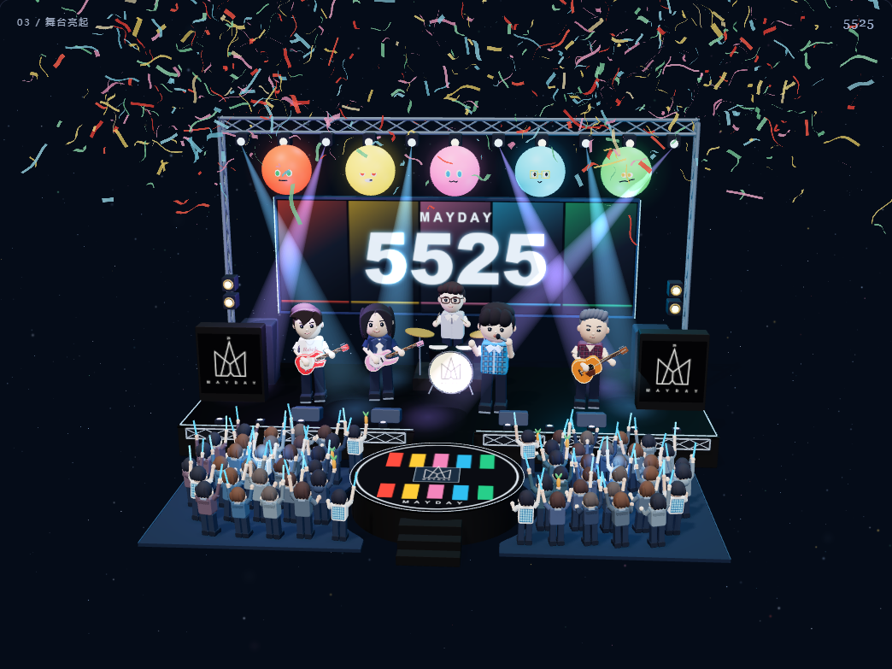

# 五月天 · 手势互动舞台

五颗球，五种颜色。用双手，把星空变成一场微型演出。

这是麦提沈制作的非官方粉丝互动作品：左手让星光凝聚、散开，右手一个 OK 点亮三维舞台。全部运行在浏览器中，无需申请接口密钥或部署业务后端。

A browser-based, hand-controlled Mayday fan project, built with Three.js, MediaPipe and Canvas.



## 直接体验

[打开在线体验](https://juncxio.github.io/mayday-gesture-stage/)

建议使用带摄像头的电脑和新版 Edge / Chrome。没有摄像头时，也可以先通过按钮体验完整场景。

首次开启手势，需要联网下载 MediaPipe 组件和手部模型。如果网络无法访问相应服务，场景与手动按钮仍可体验；手势识别需在组件成功加载后使用。

## 下载并在自己的电脑上运行

不熟悉 Git 的用户，可以在本仓库点击 **Code → Download ZIP**，解压后打开整个文件夹。

安装 [Node.js 22 或更新的 LTS 版本](https://nodejs.org/)，在项目目录运行：

```sh
npm start
```

打开 <http://127.0.0.1:8000/>，并保持终端窗口运行。不需要执行 `npm install`。

Windows 用户也可以双击 `start-windows.cmd`，再打开窗口中显示的地址。

如果已经安装 Python 3，也可在项目目录运行：

```sh
python -m http.server 8000 --bind 127.0.0.1
```

请通过本地服务访问，不要直接双击 `index.html`。摄像头要求 HTTPS 或 `localhost` / `127.0.0.1` 环境；用其他设备访问普通 HTTP 的局域网地址，可能无法开启摄像头。

## 双手怎样操作

先点击“开启双手互动”，允许摄像头访问，并让双手分开、完整入镜。页面会显示左右手是否已识别。

| 状态 / 动作 | 画面变化 |
| --- | --- |
| 左手张开并轻移 | 在星空中带起局部涟漪 |
| 左手握拳 | 星光凝成一颗表情球 |
| 左手张开，再次握拳 | 散回星空，再依次切换红、黄、粉、蓝、绿五颗球 |
| 球体出现后轻移右手 | 眼神与身体跟随，停住片刻会有短回应 |
| 右手比 OK，其余三指展开 | 点亮舞台，舞台出现时自动落下一场彩带 |
| 舞台中右手比 2 | 单独重播彩带；松开后可再次触发 |
| 舞台中轻移右手 | 带动扫灯与蓝色应援光区 |
| 舞台中左手先握拳，再张开 | 退出舞台，散回星空 |

手势需要短暂稳定确认；保持同一手势不会连续触发。双手短暂丢失时，当前球体或舞台不会直接消失。

也可使用页面按钮，或按空格键聚合 / 散开、`O` 点亮舞台、`R` 重新开始。“暂停动态效果”可以暂停场景运动；系统开启“减少动态效果”时，页面会相应减少持续动效。

## 录制互动视频

切换到“竖屏录制 · 4:5”，开启摄像头后点击“开始录制”。三秒准备后开始，点击“停止”结束。

- 输出画面为 1200 × 1500，上方 60% 为三维画面，下方 40% 为人物和手部骨架。
- 支持时优先生成 H.264 MP4；实际格式由浏览器与设备能力决定。
- 不采集麦克风，不附带音乐，可下载后自行剪辑配乐。
- 关闭摄像头或离开页面会结束录制，下载前请保持页面打开。

摄像头画面、手部关键点和录制文件在当前浏览器中处理，本项目没有上传这些数据的接口。加载识别组件与模型时，会向对应资源服务发起下载请求。

## 在成品上修改

项目为原生 JavaScript，不需要打包构建。可用编辑器或支持本地文件修改的编程工具打开整个目录，修改后刷新浏览器。

| 想修改的内容 | 主要文件 |
| --- | --- |
| 页面文字、布局与录制界面 | `index.html` |
| 手型判定、稳定时间与切换规则 | `src/core.js` |
| 三维星空、转场与相机 | `src/scene.mjs`、`src/star-flow.mjs` |
| 球体、五官与跟随回应 | `src/live-balls.mjs`、`src/hand-motion.mjs` |
| 人物、舞台与观众模型 | `src/models.mjs` |
| 扫灯、人物动作与彩带 | `src/live-stage.mjs`、`src/effects.mjs` |
| 舞台主屏、鼓面与标识贴图 | `src/stage-art.mjs` |
| 摄像头、界面状态与视频录制 | `src/runtime.js` |

建议保留一份原版，每次围绕一个目标修改。更换主屏的方法见 [主屏素材说明](assets/README.md)。

## 开源版与视频演示的区别

开源版保留星光、五颗表情球、三维舞台、双手交互和视频录制。视频演示中使用的演出照片未随仓库分发，默认主屏改为程序绘制的五色图案。仓库也不包含歌曲、演出录像、销售资料或付费教学材料。

## 开发检查

```sh
npm test
```

测试覆盖手势门控、五色循环、舞台退出、连续跟随、人物动作、流场及本地预览入口。真实摄像头下的识别效果和帧率，仍需结合自己的设备、光线和浏览器检查。手机和平板可打开页面，完整双手体验与录制建议使用电脑。

## 许可与第三方组件

本仓库的项目代码采用 [MIT License](LICENSE)，保留版权和许可证即可修改、分发及使用。第三方组件遵循各自许可，详见 [第三方组件说明](THIRD_PARTY_NOTICES.md)。

这是非官方粉丝作品，与五月天及其相关权利方没有官方隶属关系。代码许可证不授予乐队名称、商标、人物形象、音乐或演出影像等第三方内容的使用权。自行添加的素材应具有相应使用权限。

作者：[麦提沈 / JunCxio](https://github.com/JunCxio)。遇到可复现的问题，欢迎提交 Issue，注明设备、浏览器、操作步骤与报错信息。
